<p align="center">
  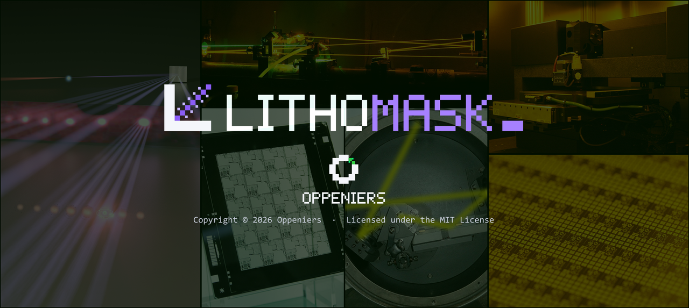
</p>

<h1 align="center">LithoMask</h1>

<p align="center">
  <b>Free, open-source photomask layout, optical proximity correction (OPC) and e-beam hand-off<br>in a single desktop application.</b>
</p>

<p align="center">
  <a href="https://github.com/AtharvSagare/LithoMask/releases/latest"></a>
  <a href="https://github.com/AtharvSagare/LithoMask/releases"></a>
  <a href="LICENSE"></a>
  
  
  <a href="https://github.com/AtharvSagare/LithoMask/actions/workflows/tests.yml"></a>
</p>

<p align="center">
  <a href="https://github.com/AtharvSagare/LithoMask/releases/latest"><b>⬇ Download</b></a> ·
  <a href="docs/INSTALL.md">Installation</a> ·
  <a href="docs/LithoMask_User_Guide.pdf">User Guide (PDF)</a> ·
  <a href="#-features">Features</a> ·
  <a href="#-simulation-results">Results</a> ·
  <a href="CONTRIBUTING.md">Contribute</a>
</p>

---

## What is LithoMask?

**LithoMask** is a free and open-source photomask design tool with computational lithography built in. It combines a
fast, CleWin-style vector layout editor with a physically based imaging simulator, a full OPC engine, print
verification and a JEOL52 e-beam writer hand-off — so you can go from *"I drew a contact array"* to *"here is the
corrected, verified, fractured mask package"* without leaving one program.

It was designed and developed by **Atharv Sagare** for **Oppeniers** — a non-profit,
open-source initiative — for researchers, students and cleanroom users who need mask tooling but do not have access to
commercial EDA licences.

> LithoMask is inspired by the workflow of popular mask-layout editors such as CleWin, and extends that kind of workflow
> with simulation-driven OPC and verification. It is an independent project and is not affiliated with or endorsed by
> the makers of CleWin, JEOL, GenISys (Layout BEAMER) or any other product mentioned here; those names belong to their
> respective owners and are used only to describe file-format compatibility.

<p align="center">
  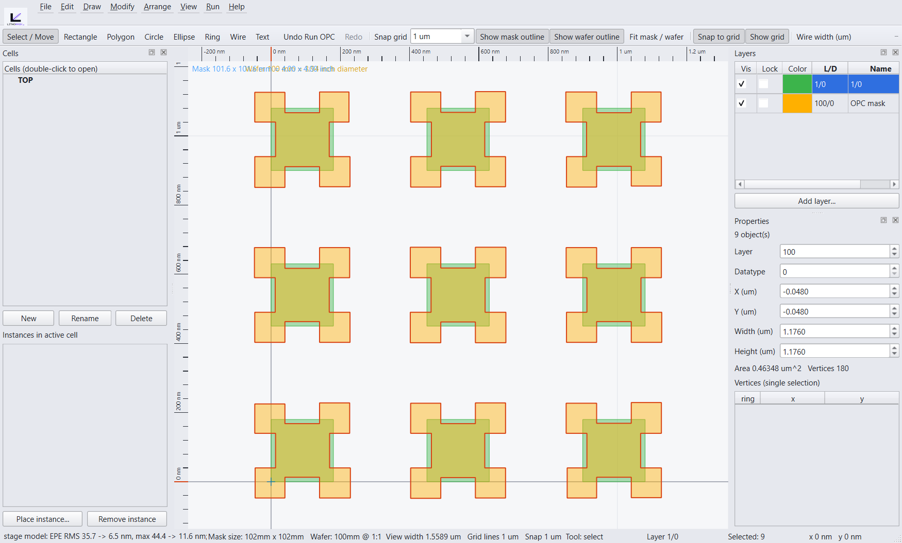
  <br><sub><b>The LithoMask editor</b> — a 3×3 contact array (green, target) with its model-based OPC mask (orange). The status bar reports
  the simulated edge-placement error dropping from <b>35.7 nm RMS to 6.5 nm RMS</b>.</sub>
</p>

---

## ⬇ Download

Everything you need is on the **[Releases page](https://github.com/AtharvSagare/LithoMask/releases/latest)**.

| File | What it is | Best for |
|---|---|---|
| **`LithoMask-Setup.exe`** | Windows installer (per-user, no admin rights needed). Adds Start-menu and desktop shortcuts. | Most people |
| **`LithoMask.exe`** | Portable single-file application — download and double-click. | USB sticks, locked-down lab PCs |
| **`LithoMask_User_Guide.pdf`** | 22-page illustrated manual. | Learning the program |

No Python installation is required for the two Windows downloads. Prefer source? See [Run from source](docs/INSTALL.md#option-c--run-from-source-python).

➡ **Full step-by-step instructions: [docs/INSTALL.md](docs/INSTALL.md)**

---

## ✨ Features

### 🖊 Mask layout editor
- **Drawing tools:** rectangle, polygon, circle, ellipse, ring, wire (path with width), text, and parametric **arrays** (rows × columns × pitch).
- **Precise editing:** every object has exact numeric properties (position, size, vertices); **move, rotate, scale, mirror, offset/bias**, align and distribute.
- **Boolean operations** (union, intersection, difference, XOR) on any selection.
- **Hierarchy:** cells with instances and arrays; a cell tree for navigation.
- **Layers:** GDS layer/datatype table with colour, visibility and lock.
- **1,000-step undo / redo** — including whole OPC runs, which are a single undoable step.
- **Smart canvas:** zoom from ~5 nm to 100 m across the window, rulers and read-outs that switch automatically between nm, µm, mm and cm, grid and snap, light/dark theme.

### 🧱 Mask & wafer awareness
- **Mask plates** (3, 4, 5, 6, 7, 9 inch, or custom) and **wafers** (1–3 inch, 100 – 450 mm, or custom) with edge exclusion and optical reduction (1×, 4×, 5×).
- Outlines drawn on the canvas, and **warnings before OPC or export** if the pattern overflows the mask, the usable wafer radius, or the plate does not fit the wafer.

### 🔬 Optical imaging & resist simulation
- **Hopkins partially-coherent imaging** with SOCS (sum-of-coherent-systems) kernel decomposition — an FFT-based aerial-image engine.
- **Illumination:** conventional, annular, dipole and quasar sources; configurable wavelength, NA, defocus; ready-made presets for 193 nm and 365 nm i-line processes.
- **Resist models:** constant-threshold, variable-threshold and a compact multi-kernel model, with sub-pixel contour extraction.

### 🎯 Optical proximity correction (OPC)
- **Model-based OPC** — edge fragmentation, EPE measurement and damped iterative correction with live progress and cancel.
- **Rule-based OPC** — pitch-dependent edge bias tables, corner serifs and notches, line-end hammerheads and contact biasing.
- **Inverse / pixel-based OPC** — gradient-descent mask optimisation, converted back to polygons.
- **SRAF insertion** — rule-based sub-resolution assist features with a printability check.
- **Tone-aware** (clear-field lines or dark-field contacts) with mask-rule limits enforced while correcting.

### ✅ Verification & sign-off
- Side-by-side **Compare** view: target · corrected mask · printed (uncorrected) · printed (corrected).
- **EPE and CD maps**, plus **hotspot detection** — bridging, pinching and line-end shortening.
- **Mask rule check (MRC)** with violation *locations*: min width, min space, min area, acute angle, min jog and mask grid.
- **Process window:** dose × defocus grid, exposure latitude and depth of focus (Bossung curves).
- One-click **HTML + PNG verification report**.

### 🧪 Model calibration
- Fit optical/resist parameters to **measured CD, space and edge-placement gauges** (CSV import).
- Global search (differential evolution) followed by least-squares refinement, with per-gauge residual reports and convergence plots.

### 📤 Export & interchange
- **GDSII**, **OASIS**, **CIF** and **DXF** layout export, with a CleWin-style `.map` layer-name sidecar. Open .mop, GDSII and OASIS files directly, or import a GDSII file as extra cells.
- **JEOL52 hand-off package** (Route B): fractured GDSII, a **Layout BEAMER** job script and settings, field / sub-field plan, per-layer dose table, JSON report and a README — ready to convert to `.v30` in BEAMER.
- Native `.mop` project format (human-readable JSON) so projects diff and version-control cleanly.

---

## 🌟 What makes LithoMask different

| | |
|---|---|
| **One tool, whole flow** | Layout → OPC → verification → process window → e-beam package. No exporting between five programs. |
| **Truly free & open** | MIT-licensed. No licence server, no dongle, no seat limit — and the program makes no network connections. Read it, teach with it, extend it. |
| **Physics you can inspect** | Every equation is documented in [`docs/technical-notes`](docs/technical-notes) with units and sources; the code states units and conventions explicitly. |
| **Honest about its limits** | Where a format is proprietary (e.g. JEOL `.v30`) LithoMask does **not** guess — it exports the supported route and says so. See [Limitations](#-limitations--roadmap). |
| **Tested** | 155 automated tests cover geometry, optics, resist, OPC, verification, calibration, export, plate rules and a GUI smoke test. |
| **Scriptable** | The whole engine is a plain Python package (`lithomask`) — use it from a notebook or a batch script without the GUI. |
| **Lightweight** | One ~110 MB portable executable, or a standard Python install of eight well-known packages. |

---

## 📊 Simulation results

All figures below were produced by LithoMask itself (193 nm, conventional illumination, scalar imaging model with a
calibrated threshold resist). The scripts that generate them are in [`examples/`](examples).

### OPC: before vs after

The same target, simulated through the same optical and resist model — once uncorrected, once with LithoMask model-based OPC.
Grey squares are the mask (serifs and hammerheads added by OPC), blue is the design intent, red is the printed contour.

| Test pattern | EPE RMS | EPE max | Hotspots (pinch / bridge) |
|---|---|---|---|
| **L-shape** | 8.6 nm → **3.2 nm** | 31.9 nm → **13.2 nm** | 2 → **0** |
| **Line end** (180 nm line) | 6.9 nm → **2.3 nm** | 29.7 nm → **12.3 nm** | 2 → **0** |
| **3×3 contact array** (GUI run) | 35.7 nm → **6.5 nm** | 44.4 nm → **11.6 nm** | MRC clean |

<p align="center">
  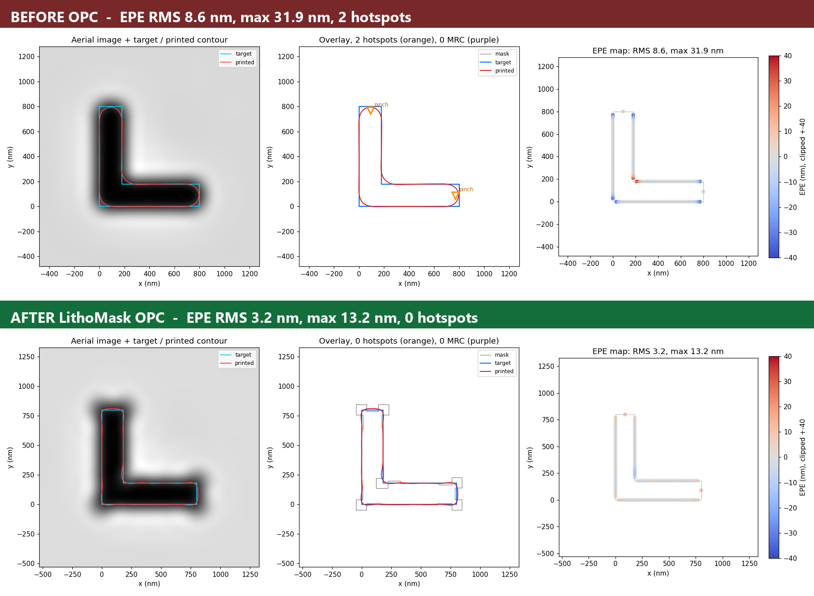<br>
  <sub><b>L-shape.</b> Corner rounding and arm-end pull-back are removed by corner serifs and edge biasing.</sub>
</p>

<p align="center">
  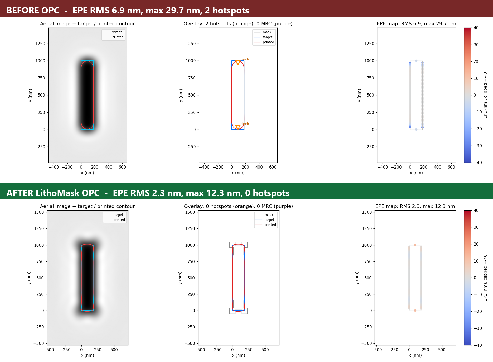<br>
  <sub><b>Line end.</b> Hammerhead assist shapes restore the line-end pull-back.</sub>
</p>

### Compare view: target, mask, print

<p align="center">
  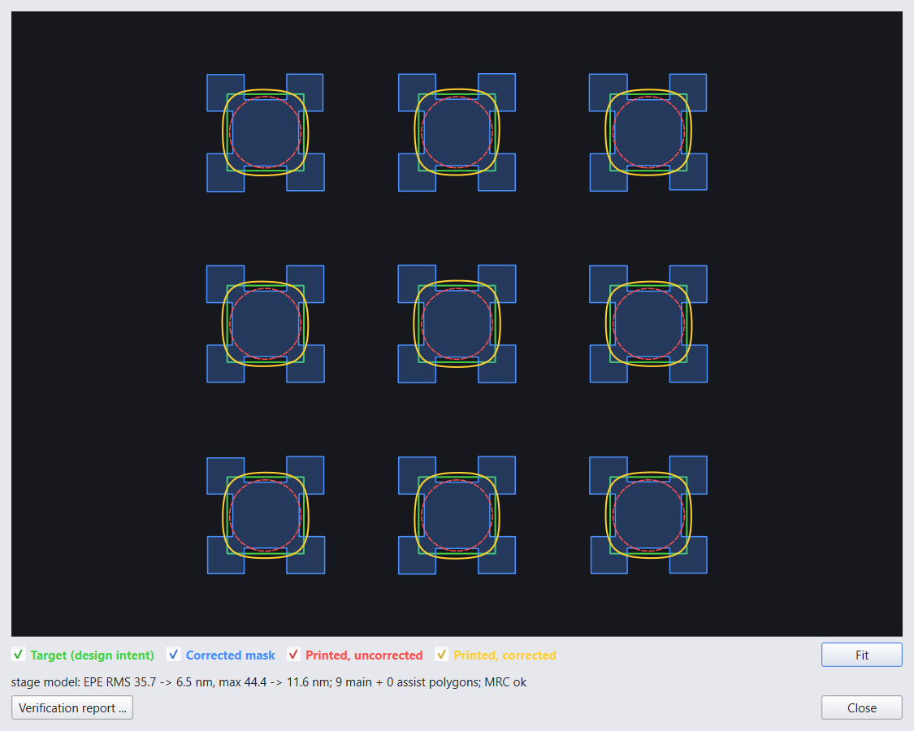<br>
  <sub><b>Compare (Ctrl+K).</b> Green = design target · blue = corrected mask · red dashed = printed without OPC · yellow = printed with OPC.</sub>
</p>

### Aerial image and resist models

<p align="center">
  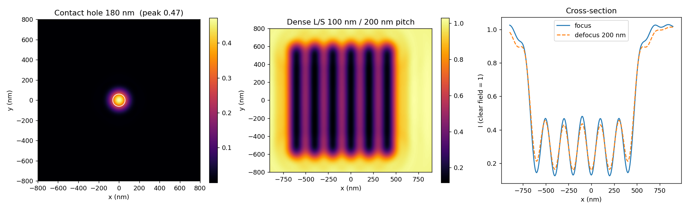<br>
  <sub><b>Hopkins aerial images</b> — a 180 nm contact hole, a dense 100 nm / 200 nm-pitch line-space pattern, and a cross-section in and out of focus (200 nm defocus).</sub>
</p>

<p align="center">
  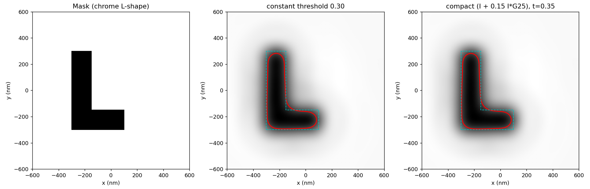<br>
  <sub><b>Resist models</b> — a chrome L-shape printed with a constant-threshold model and with the compact (I + 0.15·I⊛G) model.</sub>
</p>

### Verification: EPE map, hotspots and process window

<p align="center">
  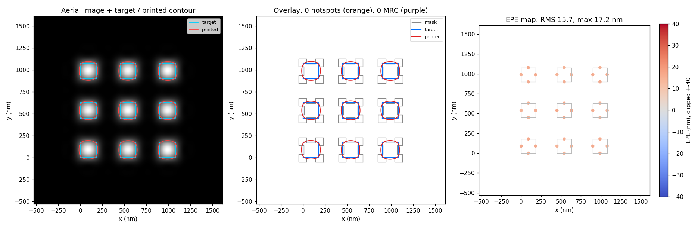<br>
  <sub><b>Contact array after OPC</b> — aerial image with target and printed contour, overlay with hotspot / MRC markers (0 / 0), and the EPE map (RMS 15.7 nm in this end-to-end demo run).</sub>
</p>

<p align="center">
  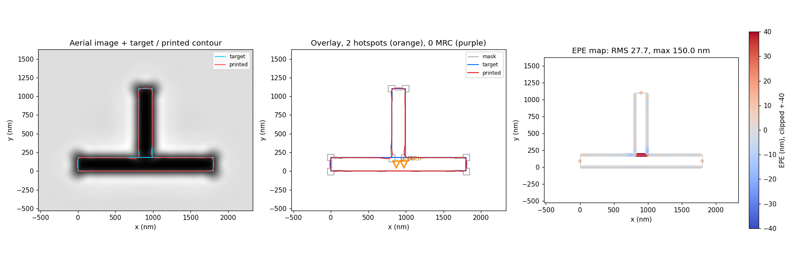<br>
  <sub><b>Hotspot detection</b> — the verifier flags two locations on a T-junction (orange) so you can review them before committing the mask.</sub>
</p>

<p align="center">
  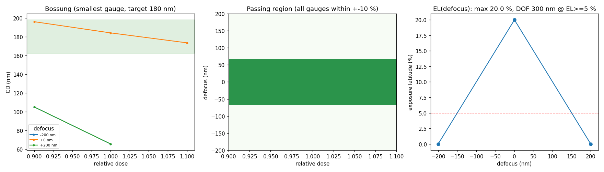<br>
  <sub><b>Process window</b> — Bossung curves, passing dose × defocus region and exposure latitude vs defocus. For this corrected line end: max exposure latitude 20 %, depth of focus 300 nm at EL ≥ 5 %.</sub>
</p>

### Model calibration

<p align="center">
  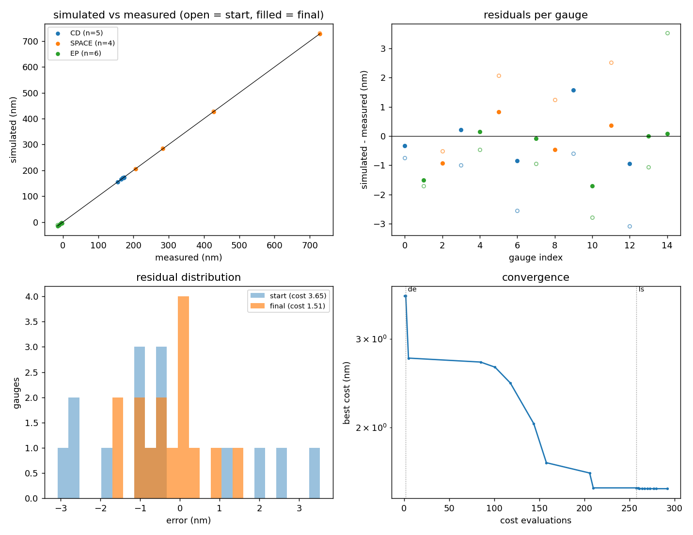<br>
  <sub><b>Calibration report</b> (synthetic benchmark, 15 CD / space / EP gauges) — the cost falls from 3.65 nm to 1.51 nm as differential evolution and least-squares refinement converge.</sub>
</p>

---

## 🖼 Gallery

<table>
  <tr>
    <td width="50%">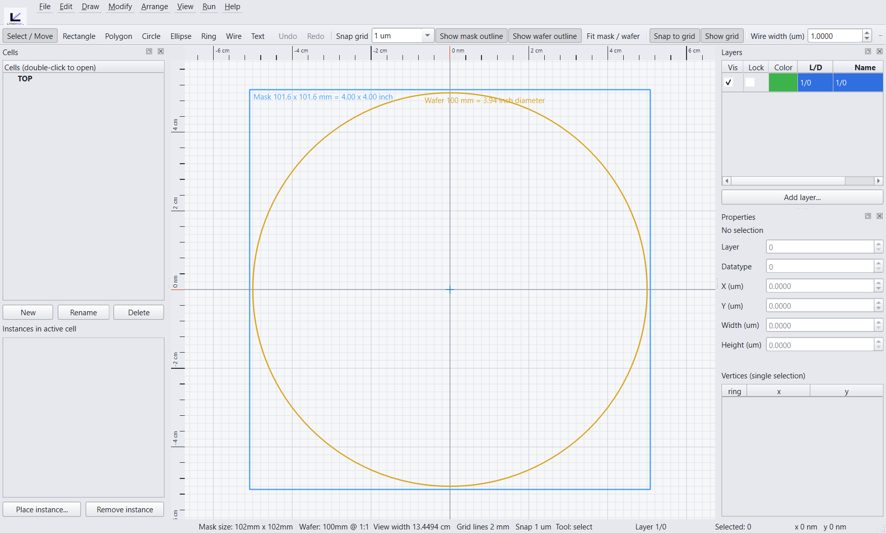<br><sub>Main window: cells, layers and properties panels around the canvas.</sub></td>
    <td width="50%">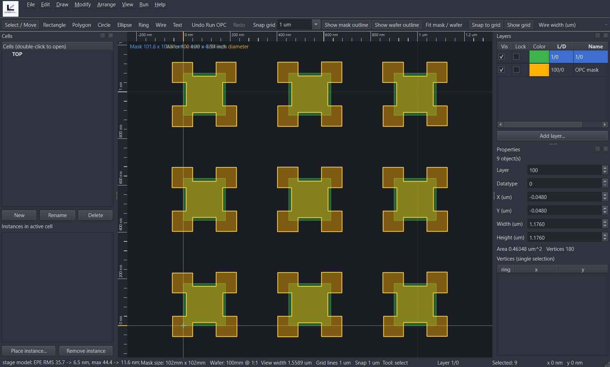<br><sub>Dark theme.</sub></td>
  </tr>
  <tr>
    <td>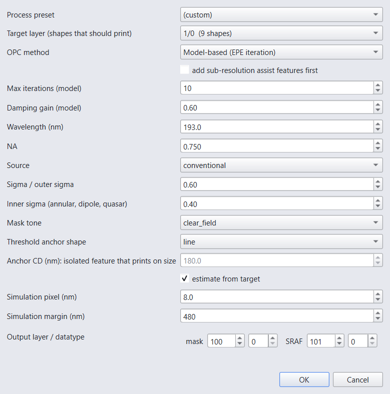<br><sub>Run OPC: presets, method, optics and grid settings.</sub></td>
    <td>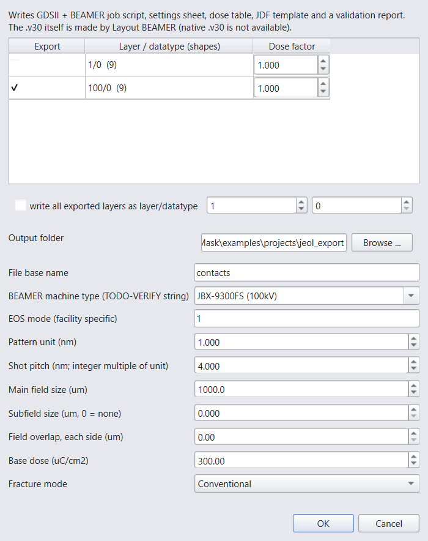<br><sub>Export JEOL52: pattern unit, fields and dose table.</sub></td>
  </tr>
  <tr>
    <td>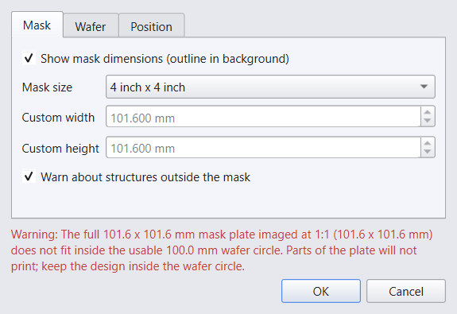<br><sub>Mask and wafer settings.</sub></td>
    <td>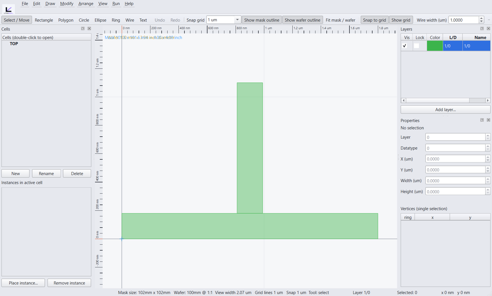<br><sub>A T-junction test layout.</sub></td>
  </tr>
</table>

---

## 🚀 Installation (quick version)

**Windows installer — recommended**

1. Open the **[latest release](https://github.com/AtharvSagare/LithoMask/releases/latest)** and download **`LithoMask-Setup.exe`**.
2. Double-click it. If Windows SmartScreen says *"Windows protected your PC"*, click **More info → Run anyway** (the app is not code-signed yet — see [why](docs/INSTALL.md#windows-smartscreen-warning)).
3. Click **Next → Install → Finish**. LithoMask starts and a desktop shortcut is created.

**Portable:** download `LithoMask.exe` and double-click it.

**From source:** `git clone https://github.com/AtharvSagare/LithoMask.git`, run `install.bat`, then `run_lithomask.bat`.

Full guide, checksum verification and troubleshooting: **[docs/INSTALL.md](docs/INSTALL.md)**.

---

## ⚡ Quick start (5 minutes)

1. **Open an example** — *File → Open…* and choose `examples/projects/contacts.mop` (or `lineend.mop`, `tjunction.mop`).
2. **Run OPC** — *Run → Run OPC…* (`Ctrl+R`), keep the defaults, press **OK**. Watch the EPE fall at each iteration.
3. **Compare** — *Run → Compare…* (`Ctrl+K`) overlays the target, the corrected mask and both printed contours.
4. **Verify** — click **Verification report…** for hotspots, MRC and EPE/CD maps (HTML + PNG).
5. **Export** — *Run → Export JEOL52…* (`Ctrl+Shift+J`) writes the fractured GDSII, BEAMER job script, dose table and README.

The [User Guide](docs/LithoMask_User_Guide.pdf) walks through every menu, panel and dialog; a plain-text quick reference is in [USER_GUIDE.md](USER_GUIDE.md).

### Use it as a Python library

```python
import lithomask as lm

lib = lm.Library.load_mop("examples/projects/contacts.mop")   # or read_gds / read_oas
# ... build geometry with lm.rectangle, lm.circle, lm.boolean, lm.offset ...
lib.write_gds("out.gds")
```

See [`examples/`](examples) for complete scripts: `aerial_demo.py`, `resist_demo.py`, `verify_demo.py`,
`calibration_demo.py`, `jeol_export_demo.py` and `end_to_end_demo.py` (layout → OPC → verification → JEOL52 package).

---

## 🏗 Architecture

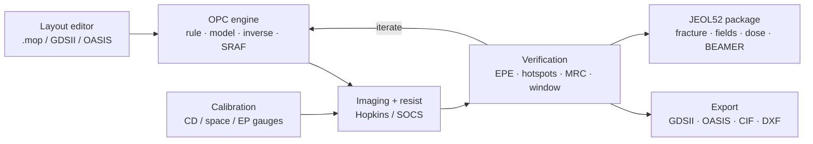

```
lithomask/
├── geometry.py, layout.py, edit.py    polygon model, cells/libraries, GDSII/OASIS/.mop I/O, undoable commands
├── optics.py                          source, pupil, TCC → SOCS kernels, FFT aerial image
├── resist.py                          threshold / variable-threshold / compact models, contour extraction
├── opc/                               rule, model-based, inverse and SRAF engines
├── verify/                            EPE/CD, hotspots, mask rule check, process window
├── calibration/                       gauges, cost functions, optimisers, reports
├── export/                            fracturing, fields, dose table, BEAMER script, JEOL52 package, interchange
├── plate.py                           mask / wafer geometry rules
├── workflow.py                        one-call OPC → verify → export pipeline and process presets
└── gui/                               PySide6 application
```

Technical derivations and sources (Hopkins/TCC/SOCS, resist model, cost functions, JEOL concepts) live in
[`docs/technical-notes`](docs/technical-notes).

---

## 🧪 Tests

```bash
pip install -r requirements.txt
python -m pytest -q          # 155 tests; the full suite takes about 10 minutes
```

The GUI smoke test runs headless (`QT_QPA_PLATFORM=offscreen`).

---

## ⚠ Limitations & roadmap

LithoMask is research and teaching software. Please read these before relying on it for a production tape-out.

- The imaging model is **scalar** (no vector / mask-3D effects); the resist model is a **calibrated threshold** model.
  Always calibrate against your own process data (`lithomask.calibration`).
- **Inverse (pixel-based) OPC is slow** — minutes for realistic windows.
- **JEOL `.v30` is not written natively.** The format is licensee-only and has no public specification, so LithoMask
  produces the supported *Route B* package (GDSII + BEAMER job script) and you convert in Layout BEAMER. A native writer
  will only be added once a real facility `.v30` sample can be parsed, rewritten and byte-compared.
- Windows is the supported platform for the packaged apps (the source runs wherever PySide6 does, but is not yet tested elsewhere).
- LithoMask prepares and simulates mask data. It does **not** replace facility process calibration, mask-shop design-rule
  review or e-beam writer qualification.

**Roadmap ideas:** a vector imaging model, code-signed installers, Linux/macOS builds, more process presets, and a native
`.v30` writer once a real sample is available. Ideas and pull requests are welcome — see [CONTRIBUTING.md](CONTRIBUTING.md).

---

## 📖 Citing LithoMask

If LithoMask helps your research, please cite it — GitHub's **“Cite this repository”** button (from
[`CITATION.cff`](CITATION.cff)) gives you BibTeX and APA.

## 📜 License

LithoMask is released under the **[MIT License](LICENSE)** — free for personal, academic and commercial use.
Third-party components keep their own licences; see [THIRD_PARTY_NOTICES.md](THIRD_PARTY_NOTICES.md).

## 👤 Author

**Atharv Sagare** — creator and lead developer, for **Oppeniers** (non-profit, open source).
[GitHub](https://github.com/AtharvSagare) · [LinkedIn](https://www.linkedin.com/in/atharv-sagare-36414b276)

<p align="center">
  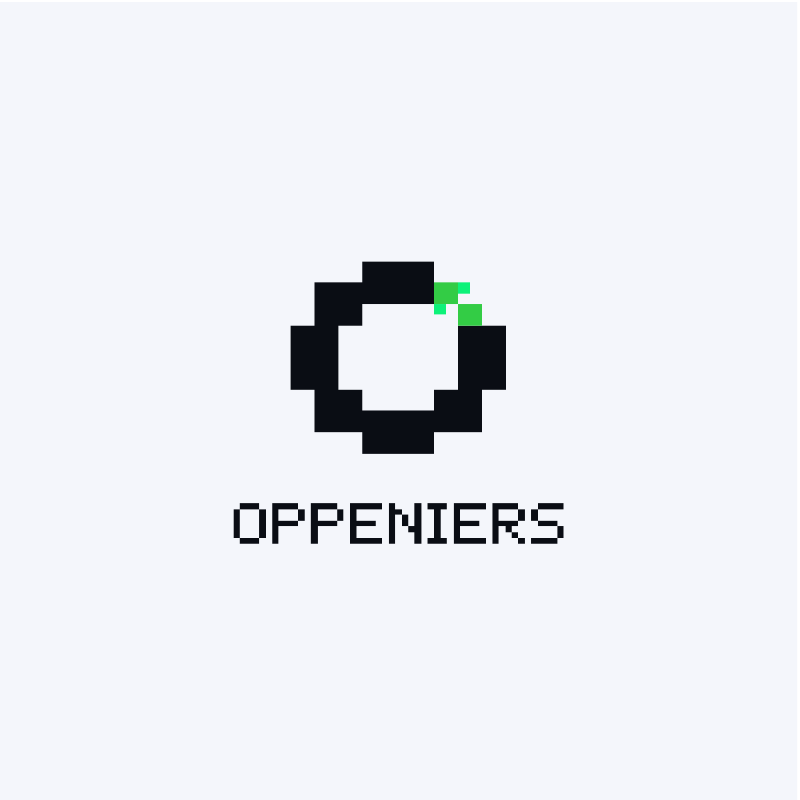<br>
  <sub>If LithoMask is useful to you, a ⭐ on the repository helps other researchers find it.</sub>
</p>
